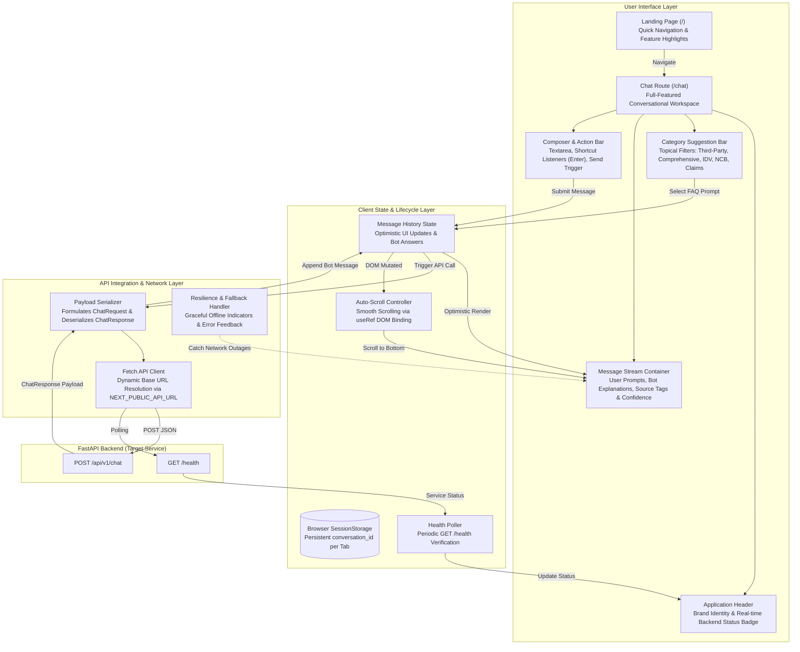
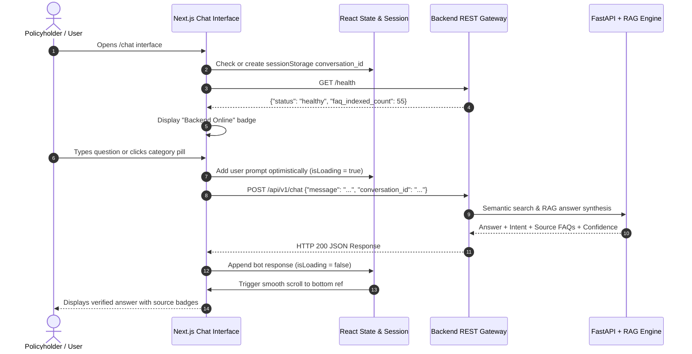

# 🚗 AI-Powered Vehicle Insurance FAQ Chatbot - Frontend

A modern, responsive, and intuitive web application providing an interactive conversational interface for the AI-Powered Vehicle Insurance FAQ Chatbot. Built with **Next.js 15 (App Router)**, **React 19**, **TypeScript**, and **Tailwind CSS**.

---

## 🏛️ Application Architecture

The frontend is architected as a modular Single-Page Application (SPA) leveraging Next.js App Router, client-side session state management, and real-time backend health monitoring.



---

## 🧩 Architectural Layers & Components

### 1. App Router & Navigation Architecture
- **Root Layout (`src/app/layout.tsx`):** Provides global metadata, typography styling via Tailwind CSS, and base responsive HTML containers.
- **Landing Gateway (`src/app/page.tsx`):** Showcases product capabilities, common insurance inquiry categories, and quick links to open the chat interface.
- **Dedicated Chat Route (`src/app/chat/page.tsx`):** Isolated workspace dedicated to the conversation session, message streaming, and source citations.

### 2. State Management & Lifecycle Architecture
- **Session Continuity:** Generates and maintains a unique `conversation_id` in `sessionStorage` per browser tab. This enables multi-turn conversation tracking across requests without requiring mandatory user authentication.
- **Optimistic Message Updates:** Immediately appends the user's inquiry to the local message list while transitioning the UI into a loading state, providing instant feedback.
- **DOM Auto-Scrolling:** Leverages React's `useRef` tied to the scroll anchor, automatically executing smooth scrolling upon new incoming messages or status changes.

### 3. Component & UI Architecture
- **Interactive Quick Pills:** Categorized chip buttons allowing users to explore popular insurance topics (e.g., *IDV Calculation*, *NCB Transfer*, *Cashless Garage Claims*) with one click.
- **Attribution & Metadata Badges:** Renders metadata returned from the backend, including detected user intent, retrieved FAQ source IDs (`faq_001`, `faq_002`), and retrieval confidence scores.
- **Backend Health Badge:** Dynamically displays whether the FastAPI backend server is `online`, `offline`, or `checking`, keeping users informed of connectivity status.

### 4. API Communication & Resilience Architecture
- **Configurable Network Boundary:** All API requests dynamically resolve the backend URL through `NEXT_PUBLIC_API_URL`, supporting local development and cloud deployments seamlessly.
- **Graceful Error Handling:** If the backend is unreachable or returns an HTTP error, the application displays an informative error card without breaking the interface.

---

## 🔄 User Interaction & Message Sequence



---

## 🛠️ Technology Stack & Rationale

| Technology | Role | Rationale |
|---|---|---|
| **Next.js 15 (App Router)** | Web Framework | Server-driven rendering, optimized bundles, fast routing, and built-in Turbopack bundler. |
| **React 19** | UI Library | Modern component lifecycle, declarative hooks (`useState`, `useEffect`, `useRef`), and high rendering efficiency. |
| **TypeScript** | Type Safety | Enforces strict compile-time types for messages, payloads, and component props, preventing runtime errors. |
| **Tailwind CSS** | Styling System | Utility-first responsive styling ensuring rapid development and lightweight production stylesheets. |
| **Lucide React** | Iconography | Lightweight, consistent SVG icon set for navigation, status indicators, and category pills. |

---

## 🚀 Setup & Execution Guide

### 1. Prerequisites
- Node.js 18.17 or later
- npm, yarn, or pnpm
- Running FastAPI backend (default: `http://127.0.0.1:8000`)

### 2. Installation
```bash
# Navigate to the frontend directory
cd frontend

# Install dependencies
npm install
```

### 3. Environment Configuration
Create a `.env.local` file from the provided template:
```bash
cp .env.example .env.local
```

Set the backend API URL in `.env.local`:
```env
NEXT_PUBLIC_API_URL=http://127.0.0.1:8000
```

### 4. Development Server
Start the Next.js development server with Turbopack:
```bash
npm run dev
```
Open [http://localhost:3000](http://localhost:3000) or navigate directly to the chat interface at [http://localhost:3000/chat](http://localhost:3000/chat).

### 5. Production Build & Execution
```bash
# Build optimized production bundle
npm run build

# Start production server
npm run start
```

### 6. Linting
```bash
npm run lint
```
